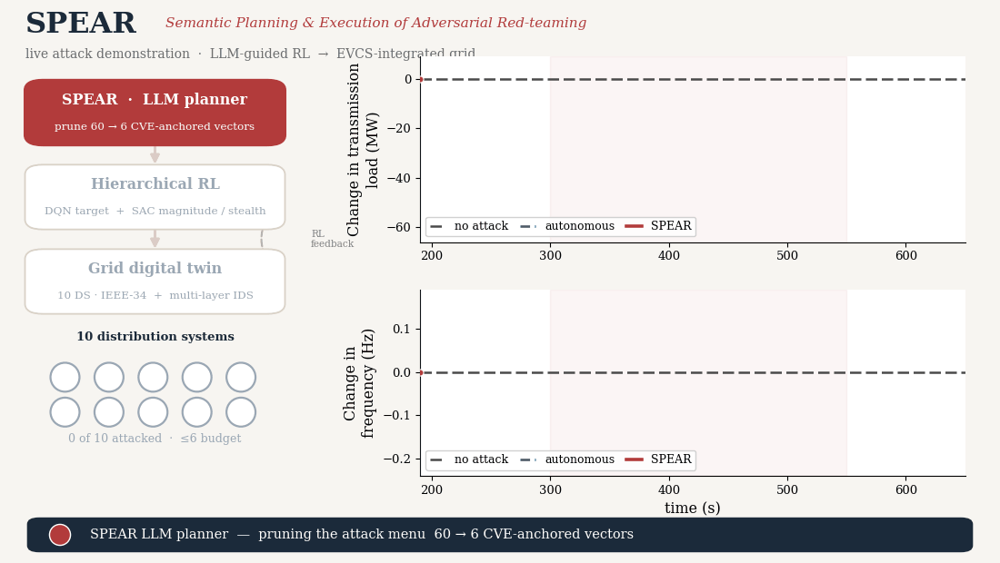

# SPEAR

SPEAR (Semantic Planning and Execution of Adversarial Agentic Reinforcement
Learning) is a research framework for evaluating cyber-physical security in
electric-vehicle charging systems. It combines EV charging data, power-system
co-simulation, physics-informed neural networks, federated learning,
reinforcement-learning attack agents, intrusion detection, and LLM-assisted
threat analysis.

The project is intended for controlled academic simulation. It does not target
or interact with production charging infrastructure.



*Live-demo overview (regenerate with `python make_overview_gif.py`): a single
dashboard walks through one attack loop — the SPEAR LLM planner prunes the
attack menu 60 → 6, the hierarchical RL agents (DQN target + SAC parameters)
select 6-of-10 distribution systems, `power_disruption` is injected into the
grid digital twin, and the transmission-load and frequency panels plot live as
the system deviates. SPEAR's coordinated 6-of-10 cascade (≈ −59.4 MW / 0.21 Hz)
is contrasted against a single-vector autonomous baseline (≈ −10.1 MW /
0.03 Hz). The curves are an illustrative overview calibrated to the paper's
reported endpoints; the quantitative result figures come from
`make_cascade_figures.py`.*

## Capabilities

- Simulates EV charging behavior with ACN-Data and synthetic fallback data.
- Couples EVCS dynamics with IEEE 34-bus OpenDSS distribution models.
- Trains local PINN models and aggregates them with federated averaging.
- Models six attack families with DQN and SAC agents.
- Benchmarks classical, neural, and ensemble intrusion-detection models.
- Builds a ChromaDB knowledge base from NVD, MITRE ATT&CK, STRIDE, protocol,
  PDF, and CICEVSE sources.
- Records LLM latency, token usage, attack outcomes, and evaluation metrics.

## Repository layout

| Area | Main files |
| --- | --- |
| Integrated simulation | `enhanced_integrated_evcs_system.py`, `hierarchical_cosimulation.py` |
| EVCS and ACN modeling | `evcs_dynamics.py`, `acn_sim_interface.py`, `acn_network_layout.py` |
| PINN and federated learning | `pinn_optimizer.py`, `federated_pinn_manager.py`, `federated_evcs_integration.py` |
| RL attack system | `attack_specific_rl_agents.py`, `central_rl_coordinator.py`, `dqn_sac_security_evasion.py` |
| LLM orchestration | `gemini_llm_threat_analyzer.py`, `enhanced_llm_rl_coordinator.py`, `langgraph_attack_coordinator.py` |
| Intrusion detection | `compare_ids_models.py`, `compare_ids_models_update.py`, `best_ids_model.py`, `ids_neural_models.py` |
| Evaluation | `evaluate_federated_pinn.py`, `evaluate_rl_evasion_comparison.py`, `compare_pinn_cms_vs_acn_controllers.py` |
| RAG pipeline (current) | `ares_rag/main.py`, `ares_rag/pipeline.py`, `ares_rag/collectors/` |
| RAG pipeline (legacy) | `spear_rag/main.py`, `spear_rag/pipeline.py`, `spear_rag/collectors/` |
| Sample efficiency / generalization | `spear_sample_efficiency.py`, `spear_topology_generalization.py`, `spear_seeding.py` |
| Paper figure generators | `make_cascade_figures.py`, `make_charging_time_figure.py`, `make_efficiency_figure.py`, `make_evcs_impact_figure.py`, `make_topology_figures.py` |
| Power-system models | `ieee34Mod1.dss`, `ieee34Mod2.dss`, `Run_IEEE34Mod1.dss`, `Run_IEEE34Mod2.dss` |
| Result figures | `figures/` |

## Requirements

- Python 3.9 or newer
- OpenDSS through `opendssdirect.py`
- A C/C++ toolchain when a dependency has no prebuilt wheel
- CUDA-compatible hardware is optional

Create an isolated environment and install the project dependencies:

```bash
git clone https://github.com/cps-security-703/SPEAR.git
cd SPEAR
python3 -m venv .venv
source .venv/bin/activate
python -m pip install --upgrade pip
python -m pip install -r requirements.txt
python -m pip install -r spear_rag/requirements.txt
```

Some evaluation paths can use optional packages such as `xgboost`,
`lightgbm`, `acnportal`, and `python-dotenv`. Install them if the selected
workflow reports that they are unavailable.

## Configuration

Set credentials with environment variables. Do not commit API keys or store
them in tracked text files.

```bash
export GEMINI_API_KEY="your-key"
export OPENROUTER_API_KEY="your-key"
export NVD_API_KEY="your-key"
```

`GEMINI_API_KEY` or `OPENROUTER_API_KEY` is needed only for the associated
LLM workflow. `NVD_API_KEY` is optional but increases the NVD collection rate
limit.

## Data

The repository contains project data and selected artifacts. For a fresh
ACN-Data installation, place the static dataset at:

```text
evcs_data/ACN-Data-Static-main/
```

The loaders can also generate synthetic data for workflows that support a
fallback. Results from synthetic and real ACN data should be reported
separately.

## Common workflows

Run commands from the repository root unless a command explicitly changes
directories.

### Build the RAG knowledge base

```bash
cd spear_rag
python main.py --nvd-max-results 150 --nvd-start-date 2022-01-01
```

To build without network-backed NVD or MITRE collection:

```bash
cd spear_rag
python main.py --skip-nvd --skip-mitre
```

### Train and compare IDS models

```bash
python train_lstm_ids_acn.py
python compare_ids_models_update.py
```

The comparison workflow selects a model and writes the runtime artifact under
`models/`. `best_ids_model.py` provides the runtime detector wrapper.

### Compare charging controllers

```bash
python compare_pinn_cms_vs_acn_controllers.py
```

### Evaluate federated PINN models

```bash
python evaluate_federated_pinn.py
```

### Evaluate RL evasion

```bash
python evaluate_rl_evasion_comparison.py
```

### Run the integrated simulation

```bash
python enhanced_integrated_evcs_system.py
```

The integrated workflow can be computationally expensive and may train or load
multiple PINN, IDS, DQN, and SAC models. Review the module-level configuration
values before a long run.

### Reproduce the paper figures

The headline figures are produced by self-contained generators that run the
co-simulation (10 distribution systems on the IEEE 34-bus feeder) with an
independent ACN-native controller and write PDFs under `figures/`. Each caches
its traces so it can be re-plotted quickly with `--cached`.

```bash
python make_cascade_figures.py       # transmission load + frequency: SPEAR vs autonomous
python make_charging_time_figure.py  # EVCS charging-time service degradation
python make_evcs_impact_figure.py    # per-station voltage/charging impact
python make_efficiency_figure.py     # sample-efficiency panels
python make_topology_figures.py      # zero-shot topology-adaptation panels
```

The SPEAR-versus-autonomous cascade gap is a *coordination* effect: SPEAR
hits the six-of-ten-system budget simultaneously, whereas the autonomous
baseline is single/few-vector at any instant. Sample-efficiency and
topology-generalization numbers (five independently seeded runs, pooled-SD
Cohen's d) are computed by `spear_sample_efficiency.py` and
`spear_topology_generalization.py`; seeds are set through `spear_seeding.py`.

## Attack families

SPEAR evaluates these simulated attack families:

1. Voltage manipulation
2. Current injection
3. Power disruption
4. Communication spoofing
5. Data injection
6. Protocol manipulation

Attack logic is restricted to the local simulation environment. The resulting
metrics are intended to measure detection, resilience, and mitigation behavior.

## Outputs

Depending on the workflow, generated artifacts are written to directories such
as:

- `models/` and `trained_rl_agents/` for checkpoints
- `plots/` and `sub_figures/` for visualizations
- `evaluation_results/` and `detection_results/` for metrics
- `llm_metrics/` for LLM call telemetry
- `attack_scenarios_logs/` for simulated attack records

Generated files can be large. Confirm the intended artifacts before adding them
to version control.

## Validation

Compile all Python sources without running the simulations:

```bash
python -m compileall -q .
```

Run the available RAG citation check with:

```bash
python spear_rag/test_cve_citations.py
```

Several scripts are experiment entry points rather than unit tests. Their
results depend on local datasets, checkpoints, API credentials, and optional
services.

## Licensing

No license terms are currently specified. Obtain permission from the repository
owner before copying, modifying, or redistributing the project.

## Responsible use

Use SPEAR only in isolated, authorized research environments. Validate all
simulation assumptions before drawing conclusions about operational EVCS or
power-grid security.
